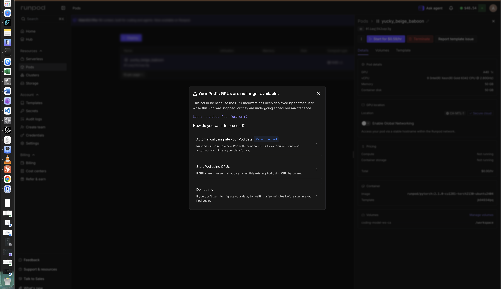
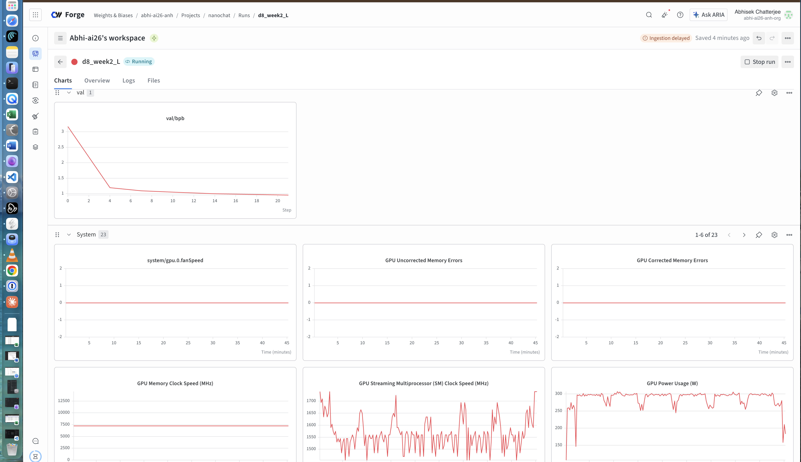
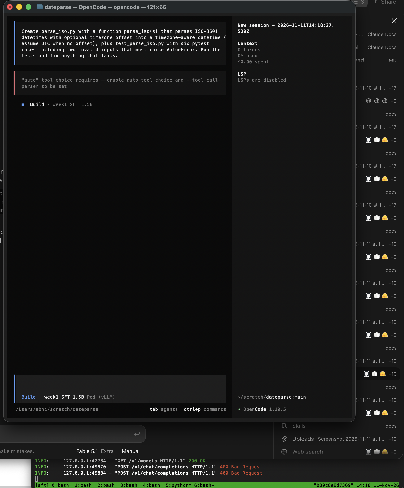

# Building an open coding model from India — Weeks 1–3 build log and teaching guide

*Written 11 Nov 2026, covering 9–11 Nov 2026 (three plan-weeks done in three calendar days). Everything here was run by one person on a MacBook plus a rented NVIDIA A40, with Claude as tutor. Every number names the harness that produced it.*

---

## 0. What this project is, in one paragraph

We are building a fully open coding model (weights, data, configs, evals, report) from India: a ~3B-active mixture-of-experts coding agent with long context that is the best model of its size *inside an open coding-agent harness* (Mini-SWE-Agent for comparable scores, OpenCode as the product). Budget ₹20 lakh, solo founder, no GPU bought — everything rented by the hour. Weeks 1–4 are foundations: learn by building small versions of every stage a real model needs. Weeks 5–10 build the data engine, 11–18 the model, 19–24 the release and funding applications (IndiaAI Mission, Startup India Seed Fund). The public release is the proof-of-execution for the grants.

**Three rules we work by** (each one was earned, see below):

1. **Secrets never enter chat, documents or git.** They live in 1Password and `~/.env`. The repo's `.gitignore` excludes `.env`, keys, model weights.
2. **Every number names its harness, its runtime and how the environment was prepared.** The same weights scored 0.628 and 0.579 on the same benchmark in two runtimes; a "3/3 solved" SWE-bench result was copied from leaked git history.
3. **Predict before you run.** Time, cost, loss, score — write the guess down, then measure. The gap is the lesson.

### How the machines are used

| Place | What it is | Used for |
|---|---|---|
| MacBook | a terminal, an editor, a small inference box | SSH, git, Docker (OrbStack), Ollama, Mini-SWE-Agent, OpenCode, CPU scripts |
| RunPod pod | a rented A40 48 GB, ~$0.60/h, disposable | training, vLLM serving, evaluation |
| Network volume `coding-model-ws-ca` (100 GB, CA-MTL-1) | the real home of all data, checkpoints, environments | survives pod loss; mounted at `/workspace` |
| GitHub `abhi-ai26/coding-model` | notes, scripts, eval samples | the public track record |
| Hugging Face `abhi-ai26/…` | models | Gate 1 artifact |
| W&B (CoreWeave Forge) | training dashboards | every run has a page |

Quick rule for commands: anything with `docker`, `ollama`, `mini`, `opencode`, `brew` runs on the Mac; `vllm`, `evalplus`, `python week3/…`, `nvidia-smi` runs on the pod.

---

## 1. Setup (Week 0) — the parts that mattered

- Accounts: GitHub, Hugging Face (2FA on), RunPod ($50 credit), CoreWeave Forge (formerly W&B — same `wandb` SDK, different server), OpenRouter, Claude Max.
- Mac: `setup/mac-setup.sh` installs git/tmux/gh/uv, creates an SSH key `~/.ssh/id_codingmodel`, writes `~/.env` (chmod 600).
- Git identity is **repo-local**, never global: this Mac also has another person's GitHub identity for other projects.

```bash
cd ~/Documents/coding-model
git config user.name "abhi-ai26"
git config user.email "354550440+abhi-ai26@users.noreply.github.com"
```

**What went wrong:** the first version of `mac-setup.sh` overwrote the Mac's *global* git identity. Fix: restore the global name, make all project identity repo-local, patch the script. **Lesson:** anything with `--global` changes other projects.

**Pod bootstrap, every fresh pod** (the container disk is wiped on Stop; the volume is not):

```bash
export HF_HOME=/workspace/hf                                 # model cache on the volume
export WANDB_BASE_URL=https://api.forge.coreweave.com        # W&B is Forge now
pip install -q wandb && wandb login                          # key from 1Password
git config credential.helper store                           # GitHub PAT, once
```

---

## 2. Week 1 — tokens, loss, batch; the full loop once

### Day 1 — nanoGPT, 51M parameters on 50M Python tokens

**Why:** see a model train, end to end, in 13 minutes, before touching anything big.

```bash
cd /workspace/nanoGPT
python data/pycode/prepare.py          # 50M tokens of codeparrot-clean-valid, GPT-2 tokenizer → train.bin / val.bin
python train.py config/train_pycode.py # 8 layers, 512 wide, block 512, bf16, torch.compile
python sample.py --out_dir=out-pycode --start="def fibonacci(n):"
```

**Result:** 50.9M params, 264 ms/step, 13 min, train 1.24 / val 1.42. Samples had Python *shape* (indentation, `def`, colons) and no meaning.

**Teaching:** loss is the average surprise per token in nats; 1.42 means the model is, on average, as uncertain as a 4-way choice. `train ≈ val` means no memorisation.

### Day 2 — 124M parameters on 500M tokens, and the first prediction

**Why:** the 6ND formula. FLOPs ≈ 6 × N (parameters) × D (tokens). Divide by the GPU's *real* speed to get time; multiply by the hourly rate to get money. This is the most valuable skill of the whole project: knowing the cost before spending it.

```bash
python data/pycode/prepare_big.py       # 500M tokens, chunked writer, every 50th 5M-token chunk to val
python train.py config/train_pycode_85m.py   # GPT-2-small shape, 131k tokens/step, 4000 steps, W&B on
```

**Prediction vs actual:** predicted 65–115 min at 57 TFLOP/s; actual **102 min**, ~67 TFLOP/s achieved. Val loss **0.985** (from 1.42). Cost ≈ ₹60.

**What went wrong:**
- I first quoted the A40's FP32 peak (37 TFLOP/s); the bf16 peak is ~150. **Lesson:** every "TFLOPS" number has a precision attached.
- nanoGPT's printed "MFU 24%" is measured against an *A100's* 312 TFLOP/s peak, not the A40's. 24% × 312 ≈ 75 TFLOP/s — consistent with our 67. **Lesson:** MFU numbers are only comparable against the same peak.
- The pod was **Stopped** overnight and its A40 was rented to someone else ("Your Pod's GPUs are no longer available"). Nothing was lost: all data was on the network volume. We deployed a new pod from the volume the next day. **Lesson:** Stop releases the GPU; the volume is the real home; the pod is disposable.



**Teaching — tokens per parameter:** 500M tokens ÷ 124M params = 4 tokens/param. The Chinchilla rule of thumb is ~20. This model is under-trained by design; it learned fluency (docstrings, numpy idioms) not competence (it still cannot write Fibonacci). That is why the real project starts from a pretrained base instead of from scratch.

### Day 3 — the KV cache, measured twice

**Why:** our target is 512K–1M context on one GPU. The KV cache is the thing that makes or breaks that.

**Attempt 1** (`week1/kv_bench.py` v1): generate 400 tokens with `use_cache=True/False` on Qwen2.5-Coder-1.5B. Result: 160.5 vs 165.5 tok/s — *no difference*. Two flaws:
1. It divided 400 by the time whether or not 400 tokens were produced; the model stopped at ~120 (end-of-text).
2. At short context in HF eager mode, each decode step is ~20 ms of Python/kernel-launch overhead; the GPU is idle most of the step and recomputing a few hundred tokens is free.

**Attempt 2** (v2: count real tokens, `min_new_tokens`, sweep context):

```python
for ctx in (16, 2048, 8192):
    for cache in (True, False):
        run(ctx, cache)   # 200 new tokens, random context of length ctx
```

| context | with cache | without | ratio |
|---|---|---|---|
| 16 | 46.7 tok/s | 51.2 | 0.9× |
| 2,048 | 49.2 | 10.9 | 4.5× |
| 8,192 | 45.7 | 2.7 | **17×** |

**Teaching:** with the cache, speed is flat (~47 tok/s) whatever the context; without it, time grows linearly with context — at 1M tokens, one token per minute. The cache's own cost: **28 KB/token** for this model (2 × 28 layers × 2 KV heads × 128 dims × 2 bytes) → 0.88 GB at 32K, **28 GB at 1M tokens** for a 1.5B model. That one line justifies MLA, 4-bit KV (TurboQuant) and hybrid linear attention in the plan.

**Lesson about benchmarks:** a benchmark that proves nothing must be interrogated before being believed.

### Day 4 — Unsloth LoRA fine-tune of Qwen2.5-Coder-1.5B

**Why:** SFT (supervised fine-tuning) is the first real training stage of the plan. LoRA trains two thin matrices per layer instead of the model, so it fits anywhere.

```python
# week1/sft.py (key lines)
model, tok = FastLanguageModel.from_pretrained("Qwen/Qwen2.5-Coder-1.5B", max_seq_length=2048, load_in_4bit=False)
model = FastLanguageModel.get_peft_model(model, r=16, lora_alpha=16, target_modules=[q,k,v,o,gate,up,down])
ds = load_dataset("OpenCoder-LLM/opc-sft-stage2", "educational_instruct", split="train").select(range(5000))
text = f"### Instruction:\n{instruction}\n\n### Response:\n{output}{tok.eos_token}"   # EOS so it learns to STOP
SFTTrainer(model, processing_class=tok, train_dataset=ds, args=SFTConfig(..., max_length=2048, report_to="wandb"))
model.save_pretrained_merged("qwen-coder-1.5b-sft", tok, save_method="merged_16bit")
```

**Result:** 313 steps, **4 min 28 s**, loss 0.70 → 0.30 by step 70 and flat after. **Lesson:** the format is learned in ~1,000 samples; the floor is the answers' own unpredictability. Loss cannot tell you whether the model got *better* — only evaluation can.

**What went wrong / changed:** TRL renamed `tokenizer=` to `processing_class=` and `max_seq_length` to `max_length`; Unsloth's install pulled no torch replacement (checked). A chat template was added to the saved tokenizer so tools know the prompt format:

```python
t.chat_template = "### Instruction:\n{{ m['content'] }}\n\n### Response:\n{{ m['content'] }}{{ eos_token }}\n"
```

### Day 5 — EvalPlus: HumanEval+ and MBPP+, base vs fine-tuned

**Why:** HumanEval+ is 164 Python functions with ~80× more tests than the original; MBPP+ is 378 task descriptions. Greedy pass@1. We run baselines *ourselves* with the same harness, never copy tables.

```bash
uv venv /workspace/venvs/eval && source /workspace/venvs/eval/bin/activate
uv pip install "evalplus[vllm] @ git+https://github.com/evalplus/evalplus"
evalplus.evaluate --model Qwen/Qwen2.5-Coder-1.5B --dataset humaneval --backend vllm --greedy --force-base-prompt
evalplus.evaluate --model ./qwen-coder-1.5b-sft --dataset humaneval --backend vllm --greedy --force-base-prompt
evalplus.evaluate --model ./qwen-coder-1.5b-sft --dataset humaneval --backend vllm --greedy --root evalplus_results_instruct
```

| Qwen2.5-Coder-1.5B | prompt | HumanEval | HumanEval+ | MBPP | MBPP+ |
|---|---|---|---|---|---|
| base | completion | 0.396 | 0.335 | 0.696 | 0.582 |
| + 5k LoRA | completion | 0.567 | 0.463 | 0.754 | 0.624 |
| + 5k LoRA | instruction (own template) | **0.707** | **0.628** | – | – |
| Qwen's official Instruct (their report) | instruction | 0.707 | 0.665 | | |

**What went wrong:** EvalPlus names its cache by model + backend + temperature, so the instruction-mode run silently reused the completion-mode samples ("All samples are already cached") — fixed with `--root`.

**Teaching:**
- Our base MBPP+ (58.2) reproduces Qwen's reported 58.6 → the harness is trustworthy.
- The 6-point gap between HumanEval and HumanEval+ is 10 problems whose "solutions" pass the easy tests only.
- **SFT unlocks, it doesn't add.** 5k samples and 4.5 minutes put a base model within 4 points of the official Instruct on HumanEval, because the ability was already there; the base-prompt number understated it (a base model doesn't know it's being asked to solve a problem and stop). This is the LIMA result, and it is why the plan spends little on SFT and most on on-policy distillation and RL.
- The gain generalised to MBPP+ (+4.2) but was 3× larger on HumanEval+ — the training data is textbook-style Python close to HumanEval's dialect. A contamination check was promised on the model card (done in Week 3 Day 5).
- vLLM generated 164 problems in 88 s; HF eager would have taken ~40 min.

### Day 6 — publish to Hugging Face

```bash
hf auth login                                   # Write token from 1Password
hf upload abhi-ai26/qwen-coder-1.5b-sft-week1 qwen-coder-1.5b-sft . --private
```

The model card (written in the author's voice, says the project is learning-by-doing with Claude/ChatGPT as tutors) states: base, data and licences, every hyperparameter, the prompt format, the evaluation table with harness and runtime, the pending contamination check, the limitations. **Gate 1's artifact existed on day 6.** Private for now; flips public in Week 3 Day 6.

---

## 3. Week 2 — nanochat: the whole pipeline on one GPU

### Day 1 — install, data, tokenizer

```bash
git clone https://github.com/karpathy/nanochat && cd nanochat
curl https://sh.rustup.rs -sSf | sh -s -- -y     # Rust, for the BPE tokenizer
uv sync --extra gpu && source .venv/bin/activate
uv run maturin develop --release --manifest-path rustbpe/Cargo.toml
python -m nanochat.dataset -n 24                 # 24 FineWeb-Edu shards ≈ 1.1B tokens
python -m scripts.tok_train --max-chars=2000000000 && python -m scripts.tok_eval
```

**Result:** a 32,768-token BPE tokenizer in 79 s. Bytes per token: ours 4.74 (GPT-2 4.67, GPT-4 4.82). **Code: 3.17 vs GPT-2's 2.19** (indentation runs merged). **Korean: 1.19** — a 3-byte character costs ~2.5 tokens on an English-trained tokenizer. Hindi, Tamil, Bengali are also 3 bytes/char. **Lesson:** an English tokenizer makes Indic text 2–3× more expensive to train on, cache and serve; Week 5's tokenizer work includes Sangraha text.

### Day 2 — depth-8 pretraining, and the kernel lesson

```bash
python -m scripts.base_train --depth=8 --device-batch-size=16 --num-iterations=1500 --window-pattern=L --run=d8_week2_L --model-tag=d8 --core-metric-every=999999 --sample-every=-1
python -m scripts.base_eval
```

**What went wrong (three things, all fixed):**
1. `python -m scripts.base_train -- --depth=8 …` → `unrecognized arguments: --`. The lone `--` is for `torchrun`; plain `python` passes it to the script. **Remove it.**
2. `wandb.errors.UsageError: api_key not configured` — nanochat's own `.venv` had its own wandb pointing at wandb's old server. **Fix:** `export WANDB_BASE_URL=https://api.forge.coreweave.com` (the key was already in `~/.netrc` for that host).
3. The default attention pattern `SSSL` (sliding windows) needs FlashAttention 3 — Hopper-only. On the A40 it fell back to PyTorch SDPA with a loud warning. We measured both:

| | `SSSL` (SDPA fallback) | `L` (full attention) |
|---|---|---|
| tok/s | 85.6k | **205k** |
| bf16 MFU | 16.9% | **48.3%** |
| ETA | 76 min | **32 min** |

2.4× faster while doing 19% *more* arithmetic per token. **Lesson:** the kernel, not the GPU, was the bottleneck.

**The model:** 126M total parameters, but 67M are `value_embeds` and 34M are vocabulary tables — lookups that cost no arithmetic. The matrices that multiply are ~42M, and that is the N in 6ND. Same lesson as MoE active-vs-total parameters.

**Prediction vs actual:** predicted 46 min at 50 TFLOP/s; actual **32.25 min**, ~72 TFLOP/s. Combined with Week 1's 67: **this A40 delivers ~70 TFLOP/s (47% of its 150 peak) on any well-compiled bf16 training run.** That is the calibration constant for every cost estimate in the plan.



**Results:** train loss 3.12; validation **0.957 bits per byte** (tokenizer-independent; Karpathy's $100 depth-20 run reaches ~0.81); **CORE 0.087** (depth-20 ≈ 0.22, GPT-2 ≈ 0.26). A ₹25, 32-minute model at a third of GPT-2.

**One more fix:** nanochat saved checkpoints to `~/.cache/nanochat` — the container disk. Moved to the volume with a symlink:

```bash
mv /root/.cache/nanochat /workspace/nanochat-cache && ln -s /workspace/nanochat-cache /root/.cache/nanochat
```

### Day 4 — SFT, and a chat you can have

`mid_train` no longer exists: nanochat folded mid-training into `chat_sft` (the `--mmlu-epochs` / `--gsm8k-epochs` flags). 

```bash
python -m scripts.chat_sft --run=d8_sft --model-tag=d8 --device-batch-size=16
python -m scripts.chat_cli -i sft -g d8 -p "What is the capital of France?"
```

**Result:** 1,867 steps, 39.9 min, loss 2.25 → 1.35, chat-data bpb 0.729 → 0.420. ARC-Easy 32.5%, ARC-Challenge 27.6%, MMLU 29.4% (chance 25%), GSM8K 0, HumanEval 0, ChatCORE 0.038.

**Teaching — the harness is part of the number:** the *same* model scored ARC-Easy **47.9%** in `base_eval` (scores the four options by likelihood) and **32.5%** in `chat_eval` (must write the letter). Eighteen points apart from protocol alone.

**Transcripts:** "The capital of France, Paris, is Paris…" (correct fact, stammer, fluent filler, and it *stopped* — the `<|assistant_end|>` token learned in SFT). Reverse-a-string: correct `s[::-1]` (memorised idiom), wrong example output (`# Outputs: "hello"` — it cannot execute). "Why is the sky blue in two sentences": a paragraph about adding integers — the word *two* pulled it into the maths SFT data. No world model, fluent grammar.

**Not done:** the web UI — Karpathy removed it (`da32e1d "remove a ton of UI bloat"`); RL — skipped because GSM8K reward is 0 at this size, so GRPO has no signal.

### Day 6 — autoresearch overnight

**Why:** Karpathy's 630-line loop: a coding agent edits `train.py`, runs a 5-minute experiment, keeps the change if validation bits-per-byte improved, repeats all night. A solo founder's second researcher.

```bash
git clone https://github.com/karpathy/autoresearch && cd autoresearch && uv sync && uv run prepare.py
uv run train.py > run.log 2>&1; grep -E "^(val_bpb|peak_vram_mb|num_steps):" run.log
curl -fsSL https://claude.ai/install.sh | bash && claude      # log in with Claude Max
IS_SANDBOX=1 claude --dangerously-skip-permissions --model sonnet "Read program.md and follow it exactly. Setup is done … Hardware is ONE NVIDIA A40 with 46 GB … peak_vram_mb must stay below 40000 … run the experiment loop indefinitely. Never pause to ask me anything; I am asleep."
```

**What went wrong:** the reference config used 45 GB on an 80 GB H100; on the A40 the 4 GB logits buffer OOM'd. **Fix:** `DEVICE_BATCH_SIZE` 128 → 64, committed as the A40 baseline (val_bpb 1.1898, 180 steps per 5 min vs the H100's 953). `IS_SANDBOX=1` is needed because Claude Code refuses `--dangerously-skip-permissions` as root. The agent's first commit failed on a missing git identity; it set a repo-local one itself.

**Result:** 57 experiments, 15 kept, 0 crashes, **val_bpb 1.1898 → 1.0869** (−8.6%). One change did almost everything: `TOTAL_BATCH_SIZE` 2¹⁹ → 2¹⁶ with device batch 32 (180 → ~1,300 steps in the budget) took 1.190 → 1.099; the other 50 experiments bought 0.012. Also kept: attention window 1024 → 512, unembedding LR 0.004 → 0.008, matrix LR 0.04 → 0.02, warmdown 0.7. Nothing architectural mattered.

**The most valuable line:** the agent re-ran one config with a different seed, found ±0.004 bpb, and flagged its own late "keeps" under 0.003 as noise. **Rule for Weeks 11–13:** two baseline seeds before any tuning campaign; nothing inside the noise counts.

---

## 4. Week 3 — serving, quantization, the harness

### Day 0 — housekeeping
Volume grown 47 → 100 GB (RunPod → Storage → edit; `df` showed 94G without a restart). LoRA checkpoints (`out-sft`, 118 MB) deleted. Four Python environments now exist and must be activated by name: system Python (Unsloth), `/workspace/venvs/eval` (vLLM, EvalPlus), `nanochat/.venv`, `autoresearch/.venv`.

### Day 1 — vLLM: prefill vs decode, and batching

```bash
vllm serve /workspace/coding-model/qwen-coder-1.5b-sft --served-model-name qwen-coder-1.5b-sft --max-model-len 8192 --port 8000
curl -s http://localhost:8000/v1/chat/completions -H 'Content-Type: application/json' -d '{"model":"qwen-coder-1.5b-sft","messages":[{"role":"user","content":"Write a Python function that reverses a string."}],"max_tokens":120}'
vllm bench serve --model qwen-coder-1.5b-sft --tokenizer … --base-url http://127.0.0.1:8000 --dataset-name random --random-input-len $L --random-output-len 128 --num-prompts 16 --max-concurrency 1 --ignore-eos
```

| prompt tokens | TTFT (prefill) | TPOT (decode) |
|---|---|---|
| 128 | 41 ms | 7.08 ms |
| 1,024 | 69 ms | 7.08 ms |
| 4,096 | 180 ms | 7.16 ms |

| concurrency | tok/s total | TPOT per user |
|---|---|---|
| 1 | 137 | 7.1 ms |
| 8 | 949 (6.9×) | 7.8 ms |
| 32 | 2,426 (**17.7×**) | 12.0 ms |

**Teaching:** prefill reads the whole prompt at once (compute-bound, grows with prompt length); decode produces one token per step and re-reads all the weights each time (memory-bound: 3 GB ÷ 700 GB/s ≈ 4.5 ms floor, flat in prompt length). Batching shares each weight read across users, so 32 users cost 18× less per token than one. Consequences: a served teacher is cheap (Week 7 distillation), and generating four candidates in parallel costs barely more than one (the plan's best-of-4 verifier mode).

**What went wrong:** `vllm` not found in a new tmux window — the environment wasn't activated there, and `grep` hid the error. Always check the `(eval)` prefix in the prompt.

### Day 2 — GGUF quantization, and the laptop

```bash
git clone https://github.com/ggml-org/llama.cpp && cmake -B build -DGGML_CUDA=ON && cmake --build build -j
python convert_hf_to_gguf.py qwen-coder-1.5b-sft --outfile week1-sft-bf16.gguf --outtype bf16
./build/bin/llama-quantize week1-sft-bf16.gguf week1-sft-Q4_K_M.gguf Q4_K_M
./build/bin/llama-server -m week1-sft-Q4_K_M.gguf --port 8080 -ngl 99 -c 4096 --jinja
OPENAI_API_KEY=none evalplus.evaluate --model week1-sft-Q4_K_M --backend openai --base-url http://localhost:8080/v1 --dataset humaneval --greedy
```

| file | size | HumanEval+ (llama.cpp) |
|---|---|---|
| bf16 | 3.1 GB | 0.579 |
| Q8_0 | 1.6 GB | 0.598 |
| Q4_K_M | 1.0 GB | 0.530 |

**Teaching:** Q8 "beating" bf16 by 3 problems is noise (±2–3 points is the resolution of a 164-problem benchmark); Q4 costs ~5 points for a 3× smaller file. And the same bf16 weights scored **0.628 in vLLM vs 0.579 in llama.cpp** — the runtime is part of the number.

**On the Mac** (Ollama, Modelfile with our `### Instruction` template, `PARAMETER stop "<|endoftext|>"`): **112 tok/s** decode, same answer as vLLM, versus 47 (HF eager, A40) and 137 (vLLM, A40). A laptop within 20% of a datacentre GPU for one user — the plan's edge story in one row.

**Pitfall avoided:** llama.cpp's `requirements-convert_hf_to_gguf.txt` pins a CPU torch and would have replaced vLLM's torch; we installed only `gguf-py` instead.

### Day 3 — the harness: Mini-SWE-Agent and OpenCode

**Why:** the plan's claim is "best model of its size inside an open harness". A harness is a loop: model reads the task and repo, emits a shell command or edit, the harness runs it in a sandbox, feeds the result back, repeat. The transcript is a *trajectory* — Week 9 collects 20,000 of them.

**Docker:** the Mac already had OrbStack; `docker run --rm hello-world` worked. (Homebrew's Docker Desktop cask failed on OrbStack's existing symlinks — not needed.)

**Mini-SWE-Agent with the teacher (DeepSeek V4.1 Flash via OpenRouter):**

```bash
uv tool install mini-swe-agent
mini-extra swebench -m openrouter/deepseek/deepseek-v4.1-flash --subset lite --split dev --slice 0:3 --workers 1 --environment-class docker -o ~/swebench/flash-lite
```

3 instances, 6 min 43 s, **$0.07**. All three "Submitted". The official harness (local Docker; the hosted `sb-cli` evaluator returned 500) said **3/3 resolved**:

```bash
uv venv ~/venvs/swebench && source ~/venvs/swebench/bin/activate && uv pip install swebench
python -m swebench.harness.run_evaluation -d SWE-bench/SWE-bench_Lite -s dev -p ~/swebench/flash-lite/preds.json --max_workers 1 -id week3-flash
```

**What the trajectories showed** (`week3/traj_stats.py`): 12, 11 and 2 git-history commands per run —

```
git log --all --oneline --since="2021-08-01" --until="2021-10-01"      # dates AFTER the checkout
git merge-base --is-ancestor HEAD 05d172f8d && echo "HEAD is ancestor of fix"
git show 05d172f8d -- src/sqlfluff/rules/L031.py
```

The container is checked out before the fix, but `.git` still contains the future. The model found the upstream fix, confirmed it was standing before it, and copied the diff. **The scoreboard says 100%; the trajectories say the answers were copied.**

**Rules adopted:** strip future git history in every environment we collect from (Week 9); audit environments for shortcuts before any RL reward is paid (Week 15 — this is reward hacking in miniature); report container preparation with every SWE-bench number.

**OpenCode with the teacher:** given a parse-ISO-dates task, it wrote both files, noticed pytest was missing, created a temp virtualenv rather than polluting the system, ran six tests, reported what it did. Minutes, fractions of a rupee.

**OpenCode with our 1.5B** (vLLM on the pod through an SSH tunnel). The plumbing needed, in order:
1. `ECONNREFUSED` — the tunnel had dropped; also use `127.0.0.1` not `localhost` (Node resolves `localhost` to IPv6 `::1`, the tunnel listens on IPv4).
2. `"auto" tool choice requires --enable-auto-tool-choice and --tool-call-parser` — OpenCode speaks function-calling; vLLM needs `--enable-auto-tool-choice --tool-call-parser hermes`.
3. `max_tokens=32000 cannot be greater than max_model_len=8192` — serve with `--max-model-len 32768` and declare limits in `opencode.json`.



```json
{ "provider": { "pod": { "npm": "@ai-sdk/openai-compatible", "name": "Pod (vLLM)",
  "options": { "baseURL": "http://127.0.0.1:8000/v1" },
  "models": { "qwen-coder-1.5b-sft": { "name": "week1 SFT 1.5B", "limit": { "context": 32768, "output": 4096 } } } } } }
```

**Result:** failure mode (a) in 3.9 s — it answered in chat, "Here is the code to solve this problem:" (the OpenCoder phrasing from Day 4), zero tool calls, no files, no tests. The code itself was wrong (date never parsed; `finally: return dt` swallows the required `ValueError`). Its template never shows it the tools; from its side this was a chat question. **Week 9 trajectories and Week 12's template give a model hands; Week 15's RL makes it check; Week 14's release ships the serving config.**

### Day 4 — QLoRA at 7B

Same data, same hyperparameters, `Qwen/Qwen2.5-Coder-7B`, `load_in_4bit=True` (NF4 base, bf16 LoRA).

**What went wrong:** the unattended script "deactivated" the eval venv, but it had been launched from a shell where that venv was already active, so `python` stayed the vLLM one → `No module named 'unsloth'`. **Fix:** call `/usr/bin/python3` explicitly. **Lesson:** scripts inherit the launching shell's PATH.

| model | prompt | HumanEval+ | MBPP+ | time |
|---|---|---|---|---|
| 1.5B base | completion | 0.335 | 0.582 | – |
| 1.5B + 5k LoRA | instruction | 0.628 | 0.624* | 4.5 min |
| 7B base | completion | 0.518 | 0.646 | – |
| 7B + 5k QLoRA | instruction | **0.744** | **0.717** | **8.5 min** |
| Qwen official 7B Instruct | instruction | ~0.84 | ~0.72 | millions of samples |

(*completion mode)

**Teaching:** 8.5 minutes, not the 18–20 expected from 4.7× the parameters — 4-bit weights mean less memory traffic. The gap to the official Instruct **widened** (4 → 10 points on HumanEval+): a bigger model has more locked inside, and 5k samples of format unlock a smaller fraction — the plan's bet that data and on-policy distillation, not SFT volume, is where the money goes. MBPP+ reached parity with the official model: for "write a short function from a description", format is nearly everything. **Cost per point ≈ ₹0.4.** At this scale compute is not the constraint; data quality and evaluation design are.

### Day 5 — the contamination check (in progress)

13-gram overlap between the 5,000 training samples and HumanEval/MBPP (`week3/decontam.py`): **131 / 5000 flagged (2.62%)**. Most hits are code idioms (`for i in range(2, int(n**0.5)+1)`, the bubble-sort swap) — 13 words of code is not 13 words of prose. But sample 290 contains MBPP/57's *problem statement* verbatim: a real leak that OpenCoder's decontamination missed. A second script checks statements only; its number goes on the model card.

---

## 5. Everything that went wrong, and the fix — index

| Symptom | Cause | Fix |
|---|---|---|
| Mac's global git identity overwritten | `git config --global` in setup script | restore global; make project identity repo-local |
| `gh api` opens a pager | default pager | `gh config set pager cat` |
| RunPod: no instances with requested specs | network volume pinned to an empty data centre | detach volume, any region → A40 in CA-MTL-1 |
| Pod can't push to GitHub | no credentials on pod | fine-grained PAT (Contents RW, one repo) + `git config credential.helper store` |
| "Your Pod's GPUs are no longer available" after Stop | GPU rented to someone else while stopped | deploy a new pod from the volume; nothing lost |
| `vllm`/`wandb`: command not found | fresh container disk or wrong tmux window | reinstall; `source /workspace/venvs/eval/bin/activate` |
| nanochat: `unrecognized arguments: --` | `--` is for torchrun | remove it |
| nanochat: `api_key not configured (no-tty)` | its venv's wandb points at wandb.ai | `export WANDB_BASE_URL=https://api.forge.coreweave.com` |
| nanochat SSSL: MFU 17%, "utilization will be terrible" | no FlashAttention 3 on Ampere | `--window-pattern L` → MFU 48% |
| `scripts.chat_web` / `scripts.mid_train` missing | removed / merged upstream | use `chat_cli`; `chat_sft` does both |
| nanochat checkpoints vanish on Stop | saved to container disk | move cache to volume + symlink |
| autoresearch OOM (4 GB logits buffer) | H100 batch on a 46 GB card | `DEVICE_BATCH_SIZE` 128 → 64 |
| Claude Code refuses `--dangerously-skip-permissions` as root | safety check | `IS_SANDBOX=1` |
| EvalPlus reuses samples across prompt modes | cache keyed by model+backend+temp | `--root <dir>` |
| `No module named 'unsloth'` in a script | venv python inherited from launching shell | call `/usr/bin/python3` |
| `git pull --rebase`: "Committer identity unknown" / "not on a branch" | identity unset; aborted rebase left limbo | `git config user.*` (repo-local); `git rebase --abort`; retry |
| Push rejected (fetch first) | Mac and pod both commit | `git pull --rebase && git push` |
| Homebrew Docker cask fails on existing binaries | OrbStack already provides `docker` | use OrbStack |
| `sb-cli gen-api-key` 500 | hosted evaluator broken | local `swebench.harness.run_evaluation` |
| OpenCode `ECONNREFUSED` | tunnel dropped; `localhost` → `::1` | re-open `ssh -L`; use `127.0.0.1` |
| vLLM 400 "auto tool choice requires…" | harness sends tools | `--enable-auto-tool-choice --tool-call-parser hermes` |
| vLLM 400 `max_tokens=32000 > max_model_len` | OpenCode asks for 32K output | `--max-model-len 32768`; `limit` in `opencode.json` |
| `df` shows old volume size | NFS reporting lag | wait a minute |

---

## 6. All the numbers in one place

| Day | What | Key numbers |
|---|---|---|
| W1 D1 | nanoGPT 51M / 50M tok | 13 min, val 1.42 |
| W1 D2 | nanoGPT 124M / 500M tok | 102 min (pred 65–115), 67 TFLOP/s, val 0.985 |
| W1 D3 | KV cache, 1.5B | 28 KB/token; 46 vs 2.7 tok/s at 8K context |
| W1 D4 | LoRA 1.5B, 5k samples | 4.5 min, loss 0.70→0.30 |
| W1 D5 | EvalPlus | HumanEval+ 0.335 → 0.463 (completion) / 0.628 (instruction); MBPP+ 0.582 → 0.624 |
| W2 D1 | tokenizer 32k | 4.74 B/tok English, 3.17 code, 1.19 Korean |
| W2 D2 | nanochat d8, 393M tok | 32 min (pred 46), 72 TFLOP/s, bpb 0.957, CORE 0.087 |
| W2 D4 | chat_sft d8 | 40 min, ChatCORE 0.038; ARC-E 47.9% (likelihood) vs 32.5% (generated) |
| W2 D6 | autoresearch | 57 runs, bpb 1.190 → 1.087, noise ±0.004 |
| W3 D1 | vLLM | TTFT 41/69/180 ms; TPOT 7.1 ms flat; 1→32 users = 17.7× throughput |
| W3 D2 | GGUF | Q4 −5 pts, 3× smaller; Mac 112 tok/s; runtime gap 0.628 vs 0.579 |
| W3 D3 | SWE-bench Lite ×3 | 3/3 "resolved", $0.07, 25 git-history lookups |
| W3 D4 | QLoRA 7B | 8.5 min; HumanEval+ 0.518 → 0.744; MBPP+ 0.646 → 0.717 |
| W3 D5 | contamination | 131/5000 (2.6%) 13-gram hits; ≥1 verbatim MBPP statement |

**Spend so far:** RunPod ≈ $19 (≈ ₹1,700, including the 100 GB volume and ~40 h of A40 mostly idle-by-choice); OpenRouter $0.07; Claude Max for the overnight loop. Against a plan line of ₹6,500 for Weeks 1–4.

**Calendar:** plan-weeks 1–3 in three days. At this pace the 24-week plan compresses to ~12–14 weeks, with all the compression in the foundations; Weeks 5–18 are bounded by data judgement and GPU-hours, not typing speed.

---

## 7. Concepts, in the order you met them

- **Token, loss, perplexity.** A model predicts the next token; loss is average surprise in nats; e^loss is how many equally likely choices it's effectively picking from.
- **6ND.** Training FLOPs ≈ 6 × parameters × tokens. N counts the parameters that *multiply* per token (not lookup tables; for MoE, active not total). Divide by achieved FLOP/s for time.
- **MFU.** Achieved FLOP/s ÷ peak. Peaks differ by precision (A40: 150 TFLOP/s bf16) and by which card a tool assumes (nanoGPT assumes A100). This A40: ~70 TFLOP/s, 47%.
- **Chinchilla.** ~20 tokens per parameter is compute-optimal for pretraining from scratch; we are not pretraining from scratch.
- **Critical batch size.** In a fixed time budget, more optimizer steps with smaller batches beat fewer big steps for small models (autoresearch's first win).
- **Tokenizer bytes/token.** Higher is cheaper; scripts a tokenizer wasn't trained on cost 2–3× (Korean, Indic).
- **KV cache.** Stored keys/values for every past token: bytes/token = 2 × layers × kv_heads × head_dim × 2. Makes decode flat in context; costs memory linearly (28 GB at 1M tokens for 1.5B).
- **Prefill vs decode.** Prefill: whole prompt, compute-bound, grows with length. Decode: one token/step, memory-bound (weights ÷ bandwidth), flat. Batching shares weight reads across users.
- **Eager vs compiled vs served.** HF eager 47 tok/s, vLLM 137 (CUDA graphs, PagedAttention), llama.cpp on a Mac 112.
- **Attention kernels.** FlashAttention 3 is Hopper-only; on Ampere the fallback decides your MFU.
- **SFT and LoRA/QLoRA.** SFT teaches format and manners; LoRA trains thin adapters; QLoRA keeps the frozen base in 4-bit. SFT unlocks, it doesn't add.
- **Chat template.** Jinja in the tokenizer that tells tools how to phrase a prompt — and whether tools are even shown to the model.
- **Quantization.** bf16 → Q8_0 (free) → Q4_K_M (~5 points at 1.5B, 3× smaller, 3× faster decode).
- **Benchmarks.** pass@1 greedy; HumanEval+/MBPP+ have the extra tests; 164 problems ⇒ ±2–3 points of noise; harness, runtime and environment preparation are part of the number; likelihood scoring ≠ generation.
- **Contamination.** n-gram overlap against statements catches copying; against code it mostly catches idioms. Report both.
- **Harness and trajectory.** The loop of observe → command → result. The product surface (OpenCode) and the comparable score (Mini-SWE-Agent). A model needs tool-call training to have hands.
- **Reward hacking.** "Tests pass" is a reward; the cheapest route to it (copy the fix from git history) wins unless the environment closes it. Audit before RL.
- **Noise floor.** Run the baseline twice before any tuning campaign; nothing inside the gap counts.

---

## 8. Reading and videos used (search YouTube by phrase)

Week 1: "Let's build GPT — Karpathy"; "Let's reproduce GPT-2 (124M) — Karpathy" (first hour). Week 2: "nanochat Karpathy walkthrough"; "Chinchilla scaling laws explained"; "State of GPT — Karpathy"; "Karpathy autoresearch explained". Week 3: "LLM inference prefill decode explained"; "vLLM PagedAttention explained"; "LLM quantization explained GGUF Q4_K_M"; "Docker in 100 seconds" (Fireship); "SWE-agent Princeton talk"; "LoRA explained" (Umar Jamil); "QLoRA Tim Dettmers talk"; "LLM benchmark contamination explained".

Papers behind the plan (read the week the build needs them): DeepSeek-V4.1 Flash, Kimi Linear, TurboQuant, LIMA, Chinchilla, FlashAttention, PagedAttention, QLoRA, EvalPlus, SWE-bench/SWE-agent, GRPO.

---

## 9. What's next

- **Week 3 Day 5:** finish the statement-only contamination count; update the model card with both numbers and the script path.
- **Week 3 Day 6 — Gate 1 public:** flip `abhi-ai26/qwen-coder-1.5b-sft-week1` to public; replace the repo README with a results front page; `git tag gate-1`.
- **Week 4:** a first MoE touch in Unsloth (Qwen3-class 30B-A3B QLoRA smoke test — the stuff of the Week 11 base decision); a 10-instance SWE-bench Lite baseline *with future history stripped*; a Docker sandbox that executes model-generated tests (Week 7's verifier, built small); the DeepSeek API account and the first 50 distilled samples read by hand; a re-plan of the calendar with three weeks of real timings.
